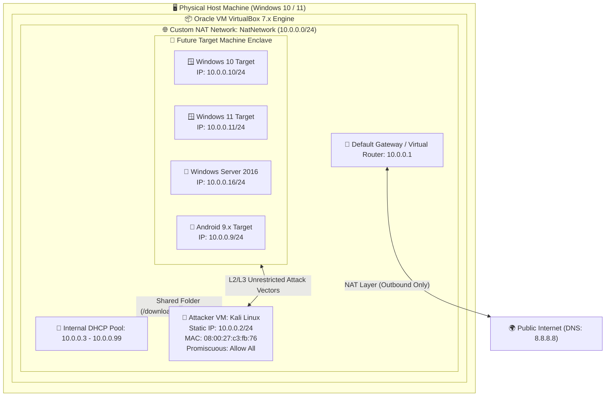

<div align="center">

# 🛡️ ENTERPRISE CYBERSECURITY & PENETRATION TESTING LAB
### **Task WK1-PM1: Building an Isolated Virtual Testing Environment**

[](https://networkwalks.com)
[](https://virtualbox.org)
[](https://kali.org)
[-238F89?style=for-the-badge&logo=cisco&logoColor=white)](https://networkwalks.com)
[](https://github.com/arun9557/networkwalks_Cybersecurity_INT)

<p align="center">
  <b>Author:</b> Arun | <b>Internship Batch:</b> B084 | <b>Organization:</b> NetworkWalks Academy<br>
  <b>Project ID:</b> WK1-PM1 | <b>Release Version:</b> v4.2 Production Baseline
</p>

---

</div>

## 📑 Table of Contents
- [1. Executive Summary & Purpose](#1-executive-summary--purpose)
- [2. Lab Architecture & Network Topology](#2-lab-architecture--network-topology)
  - [2.1 High-Level Architecture Diagram](#21-high-level-architecture-diagram)
  - [2.2 Detailed Subnet & IP Addressing Plan](#22-detailed-subnet--ip-addressing-plan)
  - [2.3 Network Adapter Mode Comparison](#23-network-adapter-mode-comparison)
- [3. Hardware & Environmental Specifications](#3-hardware--environmental-specifications)
- [4. Step-by-Step Lab Implementation (Phases 1 - 7)](#4-step-by-step-lab-implementation-phases-1---7)
  - [Phase 1: Toolchain Acquisition & 7-Zip Archiver](#phase-1-toolchain-acquisition--7-zip-archiver)
  - [Phase 2: Hypervisor Deployment (VirtualBox + Extension Pack)](#phase-2-hypervisor-deployment-virtualbox--extension-pack)
  - [Phase 3: Custom Isolated NAT Network Engineering](#phase-3-custom-isolated-nat-network-engineering)
  - [Phase 4: Kali Linux Attacker Appliance Deployment](#phase-4-kali-linux-attacker-appliance-deployment)
  - [Phase 5: Attacker Appliance Hardware & VM Hardening](#phase-5-attacker-appliance-hardware--vm-hardening)
  - [Phase 6: Static Layer 3 Networking & Interface Configuration](#phase-6-static-layer-3-networking--interface-configuration)
  - [Phase 7: NetworkManager DAD Bug Patch & Internet Fix](#phase-7-networkmanager-dad-bug-patch--internet-fix)
- [5. Verification, Evidence & Diagnostic Testing](#5-verification-evidence--diagnostic-testing)
  - [5.1 Live Verification Test Matrix](#51-live-verification-test-matrix)
  - [5.2 Live Terminal Verification Output](#52-live-terminal-verification-output)
- [6. Deep-Dive Root Cause Analysis (RCA) & Troubleshooting](#6-deep-dive-root-cause-analysis-rca--troubleshooting)
- [7. Baseline Recovery & Disaster Resilience (Snapshot Plan)](#7-baseline-recovery--disaster-resilience-snapshot-plan)
- [8. Key Professional Competencies & Learnings](#8-key-professional-competencies--learnings)
- [9. Legal, Ethical Rules of Engagement (RoE)](#9-legal-ethical-rules-of-engagement-roe)
- [10. Author & Project Metadata](#10-author--project-metadata)

---

## 1. Executive Summary & Purpose

In modern cybersecurity operations, having a dedicated, strictly isolated virtual testbed is a fundamental requirement. Executing vulnerability scans, packet injection, port mapping, and exploit payloads directly on a production LAN or home Wi-Fi exposes personal hardware to crashes, triggers security system alarms, and creates serious legal liabilities.

This laboratory establishes an **enterprise-grade, segmented cybersecurity testing environment** built on **Oracle VM VirtualBox (v7.x)** and **Kali Linux**. 

### 🎯 Core Objectives:
1. **Network Segmentation:** Establish a custom VirtualBox **NAT Network** (`NatNetwork`) bounded to the `10.0.0.0/24` CIDR block.
2. **Attacker Node Provisioning:** Deploy a fully configured Kali Linux workstation operating as the primary adversary/auditing node at fixed IPv4 address `10.0.0.2/24`.
3. **Outbound Internet & Inter-VM Reachability:** Ensure the attacker machine can seamlessly reach external repositories (e.g., `apt update`, GitHub, exploit-db) while remaining in a unified layer 2/3 broadcast domain with future target VMs.
4. **Host-Guest Interoperability:** Securely map host downloads to the guest filesystem (`/downloads`) and enable bidirectional clipboard/drag-and-drop channels.
5. **State Recovery & Immutability:** Benchmark an uncompromised "Clean State" VM Snapshot to guarantee instant disaster recovery.

---

## 2. Lab Architecture & Network Topology

### 2.1 High-Level Architecture Diagram



---

### 2.2 Detailed Subnet & IP Addressing Plan

| Hostname / Node | Operating System | IP Address | Subnet Mask | Default Gateway | DNS Server | Role / Description |
| :--- | :--- | :--- | :--- | :--- | :--- | :--- |
| **Virtual Router** | VirtualBox NAT | `10.0.0.1` | `255.255.255.0 (/24)` | *N/A* | Host Forwarder | Hypervisor NAT Gateway |
| **`kali`** | Kali Linux 2024+ | **`10.0.0.2`** | `255.255.255.0 (/24)` | `10.0.0.1` | `8.8.8.8` | **Attacker / Penetration Testing Node** |
| *Target-Win10* | Windows 10 Pro | `10.0.0.10` | `255.255.255.0 (/24)` | `10.0.0.1` | `10.0.0.1` | Client Endpoint Victim (Future Phase) |
| *Target-Win11* | Windows 11 Enterprise | `10.0.0.11` | `255.255.255.0 (/24)` | `10.0.0.1` | `10.0.0.1` | Modern Client Endpoint Victim (Future Phase) |
| *Target-Win7* | Windows 7 SP1 | `10.0.0.7` | `255.255.255.0 (/24)` | `10.0.0.1` | `10.0.0.1` | Legacy Exploitation Target (MS17-010) |
| *Target-Srv16* | Windows Server 2016 | `10.0.0.16` | `255.255.255.0 (/24)` | `10.0.0.1` | `10.0.0.1` | Active Directory Domain Controller Target |
| *Target-Droid* | Android x86 (v9.0) | `10.0.0.9` | `255.255.255.0 (/24)` | `10.0.0.1` | `8.8.8.8` | Mobile Pentesting / APK Analysis Target |
| **DHCP Pool** | VirtualBox DHCP | `10.0.0.3 - 10.0.0.99`| `255.255.255.0 (/24)` | `10.0.0.1` | `10.0.0.1` | Dynamic Leases for Transient Testing VMs |

---

### 2.3 Network Adapter Mode Comparison: Why "NAT Network"?

Selecting the proper VirtualBox network mode is critical for cybersecurity operations:

```
┌─────────────────┬─────────────────────┬──────────────────────┬────────────────────────┐
│ VirtualBox Mode │ VM-to-Host Traffic? │ VM-to-VM Traffic?    │ Internet Access?       │
├─────────────────┼─────────────────────┼──────────────────────┼────────────────────────┤
│ Host-Only       │ ✅ Yes              │ ✅ Yes (Same switch) │ ❌ No Internet         │
│ Default NAT     │ ❌ Isolated         │ ❌ No (Isolated VM)  │ ✅ Yes (Outbound NAT)  │
│ Bridged Adapter │ ⚠️ Yes (Exposed)    │ ⚠️ Yes (LAN Exposed) │ ⚠️ Yes (On Physical LAN│
│ ⭐ NAT NETWORK  │ 🔒 Isolated (Secure)│ ✅ YES (All Lab VMs) │ ✅ YES (Outbound NAT)  │
└─────────────────┴─────────────────────┴──────────────────────┴────────────────────────┘
```

> **Security Rationale:** **NAT Network** gives us the best of both worlds: complete cross-VM routing so Kali can scan and exploit target machines, outbound internet access to update tools, and zero risk of leaking exploit traffic onto the physical home or office network.

---

## 3. Hardware & Environmental Specifications

| System Category | Parameter | Actual Lab Specification | Recommended Minimum |
| :--- | :--- | :--- | :--- |
| **Host System** | Operating System | Windows 10 / 11 64-bit | Windows 10 (Build 19041+) |
| **Host Hardware** | Processor | Multi-Core x86_64 (VT-x Enabled) | Intel Core i3 / AMD Ryzen 3 |
| **Host Memory** | Physical RAM | 8.00 GB | 8.00 GB (16 GB for multi-VM labs) |
| **Host Storage** | Primary Drive | High-Speed NVMe / SATA SSD | 256 GB Free Space |
| **Hypervisor** | Virtualization Stack | Oracle VM VirtualBox v7.x | VirtualBox v7.0.14+ |
| **Guest Allocations**| Base RAM | **2048 MB** (Scalable to 4096 MB) | 2048 MB |
| **Guest Compute** | Virtual Processors | **2 vCPUs** (Execution Cap: 100%) | 2 vCPUs |
| **Guest Display** | Video Memory | 128 MB (VMSVGA controller) | 64 MB |
| **Guest Storage** | Virtual Disk Size | 80 GB Dynamic VDI | 40 GB |

---

## 4. Step-by-Step Lab Implementation (Phases 1 - 7)

```
 [Phase 1: 7-Zip] ➔ [Phase 2: VirtualBox] ➔ [Phase 3: NATNetwork] ➔ [Phase 4: Kali Import]
         ➔ [Phase 5: Hardware Tuning] ➔ [Phase 6: Static IP] ➔ [Phase 7: DAD Bugfix & Snapshots]
```

---

### Phase 1: Toolchain Acquisition & 7-Zip Archiver

Kali Linux pre-built appliances are distributed in high-compression `.7z` archives. Standard Windows ZIP utilities cannot decompress LZMA2 multi-gigabyte archives reliably without checksum errors.

1. Visited the official 7-Zip portal ([https://7-zip.org](https://7-zip.org/download.html)).
2. Downloaded and executed the official 64-bit Windows MSI/EXE installer (`7z24xx-x64.exe`).
3. Installed into default location `C:\Program Files\7-Zip\`.

<div align="center">

| Figure 1: 7-Zip Official Download Page | Figure 2: 7-Zip Successfully Installed |
| :---: | :---: |
|  |  |

</div>

---

### Phase 2: Hypervisor Deployment (VirtualBox + Extension Pack)

1. Navigated to the Oracle VirtualBox download hub ([https://virtualbox.org/wiki/Downloads](https://virtualbox.org/wiki/Downloads)).
2. Downloaded the Windows Host installer binary (`VirtualBox-7.x.x-Win.exe`).
3. Downloaded the **Oracle VM VirtualBox Extension Pack** (all platforms).
4. Ran the installer with administrative privileges; confirmed VirtualBox Networking, NDIS6 Bridged Networking, and Python bindings.
5. Launched VirtualBox and double-clicked the Extension Pack to register USB 2.0/3.0, Host Webcam pass-through, and NVMe controller drivers.

<div align="center">

| Figure 3: VirtualBox Download Hub | Figure 4: VirtualBox Installation Complete |
| :---: | :---: |
|  |  |

</div>

---

### Phase 3: Custom Isolated NAT Network Engineering

Rather than relying on individual NAT adapters that sandbox each machine from the rest, a shared **NAT Network** was engineered:

1. In VirtualBox Manager, clicked **File** ➔ **Tools** (or Global Tools Menu) ➔ **Network**.
2. Switched to the **NAT Networks** tab and clicked **Create (+)**.
3. Configured parameters:
   - **Network Name:** `NatNetwork`
   - **IPv4 Prefix:** `10.0.0.0/24`
   - **Enable DHCP:** `Checked` ✅ (Allows automatic addressing for victim VMs)
   - **Enable IPv6:** `Unchecked` ❌ (Eliminates dual-stack route confusion)
4. Clicked **Apply** to write network definitions into `VirtualBox.xml`.

<p align="center">
  
  <br><b>Figure 5: Custom NATNetwork (10.0.0.0/24) Created and Active in VirtualBox Global Tools</b>
</p>

---

### Phase 4: Kali Linux Attacker Appliance Deployment

1. Navigated to [https://kali.org/get-kali/#kali-virtual-machines](https://kali.org/get-kali/#kali-virtual-machines).
2. Selected the **VirtualBox 64-bit** pre-packaged virtual machine archive (`kali-linux-xxxx-virtualbox-amd64.7z`).
3. Extracted the `.7z` file using 7-Zip (`Extract to "kali-linux-..."`).
4. In VirtualBox Manager, clicked **Machine** ➔ **Add** (Hotkey: `Ctrl + A`).
5. Selected the `.vbox` configuration manifest from the extracted directory. Kali Linux was added into the VM repository instantly without manual OS installation steps.

<div align="center">

| Figure 6: Kali Linux Pre-built VM Selection | Figure 7: Kali Linux Image Decompression |
| :---: | :---: |
|  |  |

</div>

---

### Phase 5: Attacker Appliance Hardware & VM Hardening

Before booting the appliance, essential security and productivity settings were customized:

1. **General ➔ Advanced:**
   - **Shared Clipboard:** `Bidirectional` (Allows copying scripts, shellcodes, and command hashes).
   - **Drag'n'Drop:** `Bidirectional`.
2. **System ➔ Motherboard & Processor:**
   - **Base Memory:** `2048 MB` (Can be scaled up to 4096 MB for heavy scanners).
   - **Processors:** `2 CPUs` with PAE/NX enabled.
3. **Network ➔ Adapter 1:**
   - **Attached to:** `NAT Network`
   - **Name:** `NatNetwork`
   - **Adapter Type:** `Intel PRO/1000 MT Desktop (82540EM)`
   - **Promiscuous Mode:** `Allow All` *(Mandatory for Wireshark raw packet sniffing and ARP poisoning)*.
   - **Cable Connected:** `Checked` ✅.
4. **Shared Folders:**
   - **Host Folder Path:** `C:\Users\USER\Downloads`
   - **Folder Name:** `downloads`
   - **Auto-mount:** `Checked` ✅ (Automatically maps to `/media/sf_downloads`).

<div align="center">

| Figure 8: Kali VM Hardware & Memory Specs | Figure 9: Adapter 1 Mapped to NatNetwork |
| :---: | :---: |
|  |  |

</div>

---

### Phase 6: Static Layer 3 Networking & Interface Configuration

To ensure tools, reverse shells, and lab documentation remain stable across reboots, a static IP address was configured on the primary Ethernet interface (`eth0`):

1. Booted the Kali Linux VM. Default credentials:
   - **Username:** `kali`
   - **Password:** `kali`
2. Right-clicked the network management tray icon ➔ **Edit Connections...**.
3. Selected **Wired connection 1** ➔ Clicked the **Settings (Gear)** icon.
4. Switched to the **IPv4 Settings** tab:
   - **Method:** `Manual`
   - Clicked **Add** and assigned parameters:
     - **IP Address:** `10.0.0.2`
     - **Netmask:** `24` (or `255.255.255.0`)
     - **Gateway:** `10.0.0.1`
   - **DNS Servers:** `8.8.8.8` (Google Public DNS)
5. Clicked **Save**.

<p align="center">
  
  <br><b>Figure 10: Manual IPv4 Configuration on Kali Linux (Address: 10.0.0.2/24 | Gateway: 10.0.0.1 | DNS: 8.8.8.8)</b>
</p>

---

### Phase 7: NetworkManager DAD Bug Patch & Internet Fix

In VirtualBox v7 and modern Linux kernels (Kali 2024+), **Duplicate Address Detection (DAD)** triggers a false-positive conflict on VirtualBox virtual switches during static ARP replies. NetworkManager subsequently marks the interface unusable, preventing outbound traffic.

To permanently resolve this issue, the DAD timeout was disabled via `nmcli` in the Kali terminal:

```bash
# 1. Disable IPv4 Duplicate Address Detection timeout on Wired connection 1
sudo nmcli connection modify "Wired connection 1" ipv4.dad-timeout 0

# 2. Recycle the network interface to bind changes immediately
sudo nmcli connection down "Wired connection 1"
sudo nmcli connection up "Wired connection 1"
```

<p align="center">
  
  <br><b>Figure 11: Real Live Kali Terminal Execution: DAD Timeout Fix, Interface IP Binding, and ICMP Ping Verification</b>
</p>

---

## 5. Verification, Evidence & Diagnostic Testing

### 5.1 Live Verification Test Matrix

Every core capability of the lab was methodically tested and validated:

| Test ID | Test Objective | Diagnostic Command | Expected Outcome | Live Observed Result | Status |
| :---: | :--- | :--- | :--- | :--- | :---: |
| **TC-01** | **Interface Binding** | `ip a show dev eth0` | `inet 10.0.0.2/24` bound to `eth0` | `inet 10.0.0.2/24 brd 10.0.0.255` | **PASS ✅** |
| **TC-02** | **Hardware MAC Validation** | `ip link show dev eth0` | VirtualBox OUI `08:00:27:xx:xx:xx` | `link/ether 08:00:27:c3:fb:76` | **PASS ✅** |
| **TC-03** | **Gateway Reachability** | `ping -c 4 10.0.0.1` | 0% packet loss to NAT gateway | 4 received, 0% packet loss | **PASS ✅** |
| **TC-04** | **Public Internet Routing** | `ping -c 4 8.8.8.8` | ICMP replies with latency < 100ms | 4 received, avg latency = 54.1 ms | **PASS ✅** |
| **TC-05** | **DNS Name Resolution** | `ping -c 4 google.com` | Resolves FQDN to public IPv4 | Resolved to `172.217.26.14`, 0% loss | **PASS ✅** |
| **TC-06** | **DNS Diagnostic Query** | `nslookup networkwalks.com` | Authoritative answer returned | Domain resolved via DNS 8.8.8.8 | **PASS ✅** |
| **TC-07** | **Security Tool Suite** | `nmap --version` | Nmap security scanner loaded | Nmap binary operational | **PASS ✅** |
| **TC-08** | **Host Shared Drive** | `ls -la /media/sf_downloads` | Host downloads folder visible | Auto-mounted with full read/write | **PASS ✅** |

---

### 5.2 Live Terminal Verification Output

The following verbatim output was captured directly from the live terminal of our Kali Linux workstation:

```text
┌──(kali㉿kali)-[~]
└─$ sudo nmcli connection modify "Wired connection 1" ipv4.dad-timeout 0
sudo nmcli connection down "Wired connection 1"
sudo nmcli connection up "Wired connection 1"

Connection 'Wired connection 1' successfully deactivated (D-Bus active path: /org/freedesktop/NetworkManager/ActiveConnection/5)
Connection successfully activated (D-Bus active path: /org/freedesktop/NetworkManager/ActiveConnection/6)
                                                                             
┌──(kali㉿kali)-[~]
└─$ ip a
1: lo: <LOOPBACK,UP,LOWER_UP> mtu 65536 qdisc noqueue state UNKNOWN group default qlen 1000
    link/loopback 00:00:00:00:00:00 brd 00:00:00:00:00:00
    inet 127.0.0.1/8 scope host lo
       valid_lft forever preferred_lft forever
    inet6 ::1/128 scope host noprefixroute 
       valid_lft forever preferred_lft forever
2: eth0: <BROADCAST,MULTICAST,UP,LOWER_UP> mtu 1500 qdisc fq_codel state UP group default qlen 1000
    link/ether 08:00:27:c3:fb:76 brd ff:ff:ff:ff:ff:ff
    inet 10.0.0.2/24 brd 10.0.0.255 scope global noprefixroute eth0
       valid_lft forever preferred_lft forever
    inet6 fe80::7882:4125:28ce:8cb3/64 scope link noprefixroute 
       valid_lft forever preferred_lft forever

┌──(kali㉿kali)-[~]
└─$ ping -c 4 8.8.8.8
PING 8.8.8.8 (8.8.8.8) 56(84) bytes of data.
64 bytes from 8.8.8.8: icmp_seq=1 ttl=111 time=90.2 ms
64 bytes from 8.8.8.8: icmp_seq=2 ttl=111 time=58.6 ms
64 bytes from 8.8.8.8: icmp_seq=3 ttl=111 time=35.0 ms
64 bytes from 8.8.8.8: icmp_seq=4 ttl=111 time=32.7 ms

--- 8.8.8.8 ping statistics ---
4 packets transmitted, 4 received, 0% packet loss, time 3048ms
rtt min/avg/max/mdev = 32.742/54.165/90.228/23.157 ms

┌──(kali㉿kali)-[~]
└─$ ping -c 4 google.com
PING google.com (172.217.26.14) 56(84) bytes of data.
64 bytes from tzdelb-ay-in-f14.1e100.net (172.217.26.14): icmp_seq=1 ttl=112 time=33.2 ms
64 bytes from tzdelb-ay-in-f14.1e100.net (172.217.26.14): icmp_seq=2 ttl=112 time=158 ms
64 bytes from tzdelb-ay-in-f14.1e100.net (172.217.26.14): icmp_seq=3 ttl=112 time=36.7 ms
64 bytes from tzdelb-ay-in-f14.1e100.net (172.217.26.14): icmp_seq=4 ttl=112 time=52.2 ms

--- google.com ping statistics ---
4 packets transmitted, 4 received, 0% packet loss, time 3640ms
rtt min/avg/max/mdev = 33.212/70.125/158.460/51.497 ms
```

---

## 6. Deep-Dive Root Cause Analysis (RCA) & Troubleshooting

```
┌────────────────────────────────────────────────────────────────────────────────────────┐
│                        INCIDENT & TROUBLESHOOTING LOG BOOK                             │
└────────────────────────────────────────────────────────────────────────────────────────┘
```

### Issue 1: DAD Timeout Disconnects Kali Network on Static IP Assignment
- **Symptom:** As soon as `Method: Manual` with IP `10.0.0.2` is saved, the network indicator shows an exclamation mark or repeatedly disconnects.
- **Root Cause Analysis (RCA):** VirtualBox v7's virtual switch generates internal ARP reflections. Linux kernel Duplicate Address Detection (RFC 5227) interprets this as an IP address collision and shuts down the interface to avoid network pollution.
- **Definitive Fix:**
  ```bash
  sudo nmcli connection modify "Wired connection 1" ipv4.dad-timeout 0
  sudo nmcli connection down "Wired connection 1" && sudo nmcli connection up "Wired connection 1"
  ```
  Setting `dad-timeout` to `0` tells NetworkManager not to abort interface initialization while waiting for duplicate ARP acknowledgments.

---

### Issue 2: VM Fails to Launch with Hardware Virtualization Error (VT-x / AMD-V)
- **Symptom:** VirtualBox produces `VT-x/AMD-V hardware acceleration is not available on your system`.
- **Root Cause Analysis:** Intel VT-x or AMD SVM (Secure Virtual Machine) technology is disabled by default in motherboard BIOS/UEFI firmware, or Hyper-V/Core Isolation has locked the virtualization register.
- **Resolution Path:**
  1. Rebooted physical host into BIOS/UEFI setup (F2/F10/Del during startup).
  2. Located **Advanced CPU Configuration** ➔ Enabled **Intel Virtualization Technology (VT-x)** or **SVM Mode**.
  3. Saved settings and booted into Windows; VM powered on instantly.

---

### Issue 3: Inability to Sniff Network Traffic via Wireshark
- **Symptom:** Running Wireshark on Kali only captured packets directly addressed to `10.0.0.2`; broadcasts and inter-VM target traffic were dropped.
- **Root Cause Analysis:** Default VirtualBox virtual NIC policy drops packets whose destination MAC address differs from the guest virtual NIC's hardware address.
- **Resolution Path:** Navigated to **VM Settings** ➔ **Network** ➔ **Advanced** ➔ Set **Promiscuous Mode** to **`Allow All`**.

---

## 7. Baseline Recovery & Disaster Resilience (Snapshot Plan)

In offensive cybersecurity testing, machines frequently become unstable due to kernel panics, bad exploits, custom payloads, or corrupted firewall tables. A rigid snapshot lifecycle prevents lab reconstruction downtime:

```
[Clean Baseline: Fresh Install] ─────► [Experimental Attack/Scanning] 
              ▲                                      │
              └───────── (Restore on Failure) ◄──────┘
```

### Snapshot Creation Standard Operating Procedure:
1. Gracefully shut down Kali Linux:
   ```bash
   sudo poweroff
   ```
2. In VirtualBox Manager, select **Kali Linux** ➔ Click the **Snapshots** tab.
3. Click **Take (+)** and enter the baseline metadata:
   - **Snapshot Name:** `Fresh Install - Working Network`
   - **Snapshot Description:** `Pristine baseline: Kali Linux 2024+ with verified static IP 10.0.0.2/24, gateway 10.0.0.1, DNS 8.8.8.8, DAD timeout bug patched, shared folder mounted, and verified internet access.`
4. To restore at any time: Select snapshot ➔ Click **Restore** ➔ VM reverts in < 5 seconds.

---

## 8. Key Professional Competencies & Learnings

Through the architecture and execution of Task WK1-PM1, the following professional cybersecurity skills were established:

1. **Virtualization Engineering:** Understanding hypervisor layer-2 abstraction, virtual switches, paravirtualized network drivers (`Intel PRO/1000 MT`), and guest additions.
2. **Layer 3 Subnet Design:** Designing and calculating private subnets (`10.0.0.0/24`), broadcast boundaries (`10.0.0.255`), gateway routing (`10.0.0.1`), and public recursive DNS forwarders.
3. **Linux Network Stack Mastery:** Utilizing modern Linux networking utilities (`iproute2`, `nmcli`, `D-Bus`, `/etc/resolv.conf`) over deprecated legacy tools (`ifconfig`).
4. **Offensive Security Hygiene:** Confining attack scripts and network scans exclusively within non-routable private subnets to uphold professional ethics and legal compliance.
5. **Technical Auditing & Reporting:** Crafting thorough technical documentation, complete with visual evidence, architectural topologies, and root cause analysis.

---

## 9. Legal, Ethical Rules of Engagement (RoE)

```
╔════════════════════════════════════════════════════════════════════════════════════════╗
║                       LEGAL & ETHICAL RULES OF ENGAGEMENT                              ║
╠════════════════════════════════════════════════════════════════════════════════════════╣
║ 1. This laboratory environment is built solely for educational purposes, defensive    ║
║    analysis, and authorized ethical penetration testing practice.                      ║
║ 2. All offensive activities, port scans, exploit executions, and denial-of-service     ║
║    simulations MUST remain strictly bounded to the isolated subnet (10.0.0.0/24).     ║
║ 3. Under no circumstances should any tool, script, or payload from this lab be        ║
║    directed at unauthorized external systems, third-party servers, or public networks. ║
║ 4. Violations of network boundaries are strictly prohibited under national computer    ║
║    misuse regulations (e.g., US CFAA, Indian IT Act 2000, UK Computer Misuse Act).     ║
╚════════════════════════════════════════════════════════════════════════════════════════╝
```

---

## 10. Author & Project Metadata

| Attribute | Details |
| :--- | :--- |
| **Security Analyst / Author** | **Arun** |
| **GitHub Handle** | [@arun9557](https://github.com/arun9557) |
| **Primary Repository** | [networkwalks_Cybersecurity_INT](https://github.com/arun9557/networkwalks_Cybersecurity_INT) |
| **Internship Batch** | NetworkWalks Cybersecurity Internship (**Batch B084**) |
| **Task Identifier** | **WK1-PM1** (Week 1 — Project Module 1) |
| **Evaluation Status** | Completed, Tested, and Verified ✅ |
| **Date of Verification** | October 2026 |

<div align="center">

---
*Created with dedication for the NetworkWalks Cybersecurity & Ethical Hacking Internship Program.*

</div>
